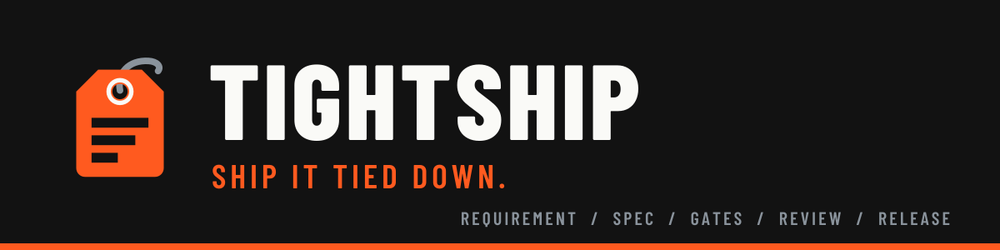

# [](https://github.com/ATNexusLab/tightship)

English · [Português](README.pt-BR.md)

[](LICENSE)
[](https://github.com/ATNexusLab/tightship/actions/workflows/rust.yml)
[](https://github.com/ATNexusLab/tightship/actions/workflows/scan.yml)
[](docs/install/claude-code/README.md)
[](docs/install/cursor/README.md)
[](docs/install/antigravity-cli/README.md)
[](https://github.com/ATNexusLab/tightship/releases)

**A workflow for AI coding agents, from requirement to release.**

tightship loads a full engineering process into your coding agent. Every change gets an issue and a spec.
Gates must come back green, and a verifier has to fail to disprove the claim of done. Only then does the
change ship. It installs as a native plugin and keeps memory across sessions and machines.

## Why

Left to its defaults, a coding agent writes fast and forgets everything between sessions. It skips the spec,
and it calls work done before anyone checks it.

Teams fix that with process: requirements with IDs, an issue for every change, gates that must pass, a
review before the commit. tightship writes that process down once and loads it into the agent, so working
alone gets the same rigor a team would demand.

## What ships

| Piece | What it does |
| --- | --- |
| Contract | Rules in every session: how the agent plans, writes code, tests, handles git and secrets, and what counts as done |
| 10 commands | One per step: `/requirements`, `/bootstrap`, `/sprint`, `/spec`, `/epic`, `/audit`, `/closeout`, `/pr-review`, `/handoff`, `/sync` |
| 13 skills | Loaded on demand: API, database, frontend, and hexagonal architecture, requirements engineering, spec writing, security audit, testing, performance, technical writing, and more |
| Verifier | A read-only subagent that tries to disprove a fix, a finding, or a "done" before you trust it |
| Memory | Optional. Curated notes in a git repository you own, shared across sessions, machines, and harnesses |
| Status line | Optional. Written to your settings only while you have it turned on |

Three companion plugins install with it. [ponytail](https://github.com/DietrichGebert/ponytail) keeps the
code to the simplest thing that works. [i-have-adhd](https://github.com/ayghri/i-have-adhd) shapes answers
so you can act on them. [humanizer](https://github.com/blader/humanizer) keeps prose from reading as
generated.

## How a change moves

```text
/requirements → /bootstrap → /sprint plan → grilling → /spec → /epic
      → plan → tests → code → gates green → /audit → /closeout → commit → PR
```

Every requirement has an ID. A spec cites the IDs it covers. An epic and its sub-issues come from the
spec. Every commit and pull request points back to its issue. Nothing is committed until the gates pass
with zero errors and zero warnings and you have read the change.

## Quickstart

Run the installer for Claude Code (2.1.295+), Antigravity CLI (1.4.0+), or both:

```sh
curl -fsSL https://github.com/ATNexusLab/tightship/releases/latest/download/install.sh | sh
```

On Windows in PowerShell:

```powershell
irm https://github.com/ATNexusLab/tightship/releases/latest/download/install.ps1 | iex
```

The installer detects your CLIs and asks which options to turn on. The install guides
([Claude Code](docs/install/claude-code/README.md), [Antigravity CLI](docs/install/antigravity-cli/README.md))
cover options, updates, uninstalling, and moving from pre-plugin installs. For Cursor (3.25.6+, `agent`
2026.10.14+), follow the [Cursor install guide](docs/install/cursor/README.md); it is not part of the unified
installer yet.

## Harnesses

| Harness | Status | Milestone |
| --- | --- | --- |
| Claude Code | Available | M1 |
| Antigravity CLI | Available | M3 |
| Cursor | Planned | M2 |
| Codex | Planned | M4 |

Every piece is written once in `content/`, which names no harness. A Rust build turns it into each
harness's native plugin format ([ADR 0001](docs/decisions/0001-rust-build-and-tokenized-canonical-content.md)).
It runs on macOS, Linux, and Windows.

## Build from source

You need `rustup`, which installs the pinned toolchain on the first `cargo` call, and gitleaks 8.30.1 on
the `PATH`.

```sh
git clone https://github.com/ATNexusLab/tightship.git
cd tightship
cargo xtask build
claude --plugin-dir dist/claude-code
agent --plugin-dir dist/cursor
```

The build needs a `.identity-terms` file at the root. [CONTRIBUTING.md](CONTRIBUTING.md) explains it and
lists every gate.

## Docs

| Where | What |
| --- | --- |
| [Install guide (Claude Code)](docs/install/claude-code/README.md) | Installing, options, updates, uninstalling, migration |
| [Install guide (Cursor)](docs/install/cursor/README.md) | Companions, marketplace install, options, uninstall |
| [Requirements](docs/requirements/README.md) | The versioned SRS: every requirement and its acceptance criteria |
| [Architecture](docs/architecture/README.md) | The system map, in arc42 sections with C4 diagrams |
| [Decisions](docs/decisions/README.md) | The architecture decision records |
| [Roadmap](docs/roadmap/README.md) | Milestones, epics, and requirement coverage |
| [Design](docs/design/README.md) | The brand, its voice, and its tokens |

## Contributing

Issues and pull requests are welcome. Read [CONTRIBUTING.md](CONTRIBUTING.md) first. Report
vulnerabilities as [SECURITY.md](SECURITY.md) says, never in a public issue. Everyone follows the
[Code of Conduct](CODE_OF_CONDUCT.md).

## License

[MIT](LICENSE) © ATNexusLab
