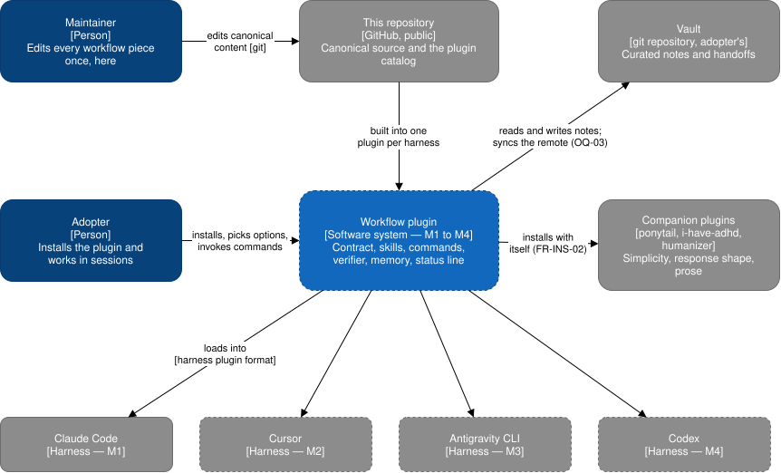

# Architecture

The map of the system, in the sections of arc42, with C4 diagrams. The structure follows
[ADR 0001](../decisions/0001-rust-build-and-tokenized-canonical-content.md). Everything not built yet
is drawn dashed, with the milestone and epic that builds it.

## Introduction and goals

The workflow is a way of working with coding agents: an always-on contract, on-demand skills, a command
per step of the development loop, a read-only verifier, an optional memory layer, and an optional status
line. The product packages it as a native plugin for four harnesses, built from one canonical source in
this repository ([SRS](../requirements/README.md)).

Quality goals, highest first:

1. One authored copy of each piece, whatever the harness ([NFR-MNT-01](../requirements/non-functional/maintainability.md#nfr-mnt-01),
   [NFR-FLEX-06](../requirements/non-functional/flexibility.md#nfr-flex-06)).
2. A plugin failure never blocks a session ([NFR-REL-01](../requirements/non-functional/reliability.md#nfr-rel-01)).
3. Nothing of the maintainer's identity or vault ships ([NFR-SEC-01](../requirements/non-functional/security.md#nfr-sec-01),
   [NFR-SEC-02](../requirements/non-functional/security.md#nfr-sec-02)).
4. Session start and each prompt stay within their time budgets
   ([NFR-PERF-01](../requirements/non-functional/performance.md#nfr-perf-01),
   [NFR-PERF-02](../requirements/non-functional/performance.md#nfr-perf-02)).

## Constraints

See [the operating environment and constraints](../requirements/overview.md).

## Context and scope

Dashed boxes are not built yet. Every element belongs to the milestone in its label.

| Element | Kind | What flows |
| --- | --- | --- |
| Maintainer | Person | Edits each workflow piece once, in this repository |
| Adopter | Person | Installs the plugin, picks its options, invokes its commands |
| This repository | External system, GitHub | Holds the canonical source and the catalog each harness installs from |
| Claude Code, Cursor, Antigravity CLI, Codex | External systems, one milestone each ([BR-01](../requirements/business-rules.md#br-01)) | Load the plugin in its harness's own format |
| Companion plugins | External systems | Installed with the plugin where the harness allows it ([FR-INS-02](../requirements/functional/install.md#fr-ins-02)); in Claude Code, as the plugin's dependencies, each from its own catalog (M1, #2) |
| Vault | External system, the adopter's git repository | Notes and handoffs the memory layer reads and writes |

Out of scope: [the SRS's list](../requirements/README.md#scope).

## Solution strategy

From [ADR 0001](../decisions/0001-rust-build-and-tokenized-canonical-content.md):

- **One authored copy, many plugins.** Every piece is one Markdown file under `content/`; a build renders
  it into each harness's plugin under `dist/`, which is never committed.
- **Harness-neutral content.** A piece refers to another piece, or to a harness capability, through a
  [token](concepts/tokens.md). Harness names, paths, and tools live only in `harnesses/<harness>/`.
- **Rust throughout.** The build is a Cargo `xtask`; the plugin ships one compiled binary, `tightship`, so an
  adopter installs no runtime.
- **The plugin installs as a release archive** that carries the binary for every target and a `sh` launcher
  that picks one.

## Building blocks

[Building blocks](building-blocks/README.md), with the C4 container diagram.

## Runtime

**Session start: the contract** (M1, #4). Claude Code starts a session, runs `/clear`, or compacts the
context, and fires the plugin's `SessionStart` hooks in parallel. Each prints one part of the contract from
`contract/`, or nothing when the contract option or its own option is `false`, and Claude Code adds each
print to the context as its own reminder ([contract](concepts/contract.md)).

## Deployment

[Deployment](deployment.md): environments, packaging, and the adopter's prerequisites.

## Crosscutting concepts

[Crosscutting concepts](concepts/README.md): tokens, options, the contract, and security.

## Architecture decisions

[Decisions](../decisions/README.md).

## Quality requirements

See [the non-functional requirements](../requirements/non-functional/README.md).

## Risks and technical debt

The known risks are the SRS's [assumptions and dependencies](../requirements/overview.md#assumptions-and-dependencies):
each harness's plugin format and the companion plugins can change without notice.

## Glossary

See [the glossary](../requirements/glossary.md).
