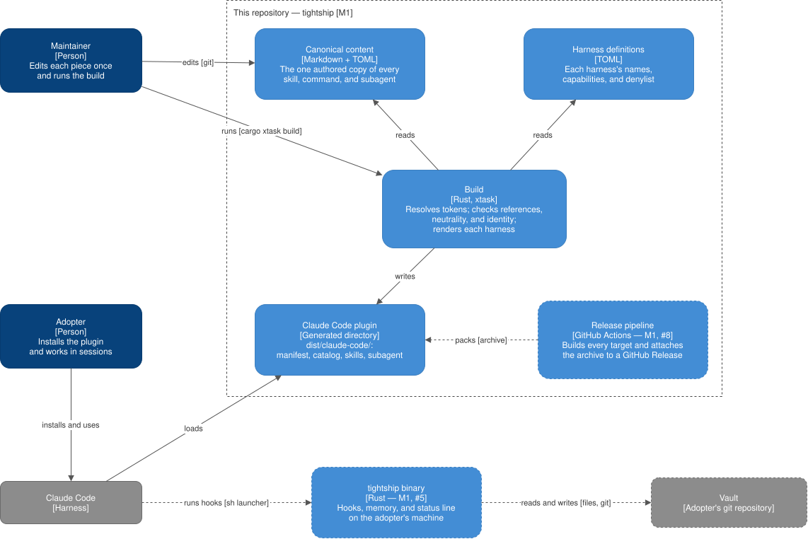

# Building blocks

What the system is made of, from
[ADR 0001](../../decisions/0001-rust-build-and-tokenized-canonical-content.md). Dashed boxes are not
built yet; each block belongs to the milestone and epic in its label.

| Block | Technology | Responsibility | Talks to | Milestone | Link |
| --- | --- | --- | --- | --- | --- |
| Canonical content | Markdown + TOML | The one authored copy of every skill, command, subagent, the contract, and the vault template | Read by the build; the template is embedded in the binary | M1, #1, #4, and #5 | [canonical-content.md](canonical-content.md) |
| Harness definitions | TOML | Each harness's names, capabilities, and denylist | Read by the build | M1, #1 | [harness-definitions.md](harness-definitions.md) |
| Build | Rust, `xtask` crate | Resolves tokens, checks references, neutrality, and identity, packs the contract, compiles the binary, and renders each harness's plugin | Reads the content and the definitions; writes `dist/` | M1, #1, #4, and #5 | [build.md](build.md) |
| Claude Code plugin | Generated directory | The plugin Claude Code loads, and its catalog: manifest, catalog, skills, subagent, `bin/`, contract and memory hooks | Loaded by Claude Code; its hooks run at session start and on each prompt | M1, #1 to #5 | [claude-code-plugin.md](claude-code-plugin.md) |
| `tightship` binary | Rust | Hooks, memory, and status line on the adopter's machine | Run by Claude Code's hooks and by the agent through `bin/tightship`; reads and writes the vault (files, git) | M1, #5 | [tightship-binary.md](tightship-binary.md) |
| Release pipeline | GitHub Actions | Builds every target and attaches each harness's archive to a GitHub Release | Packs the generated plugin with the binaries | M1, #8 | [release-pipeline.md](release-pipeline.md) |
