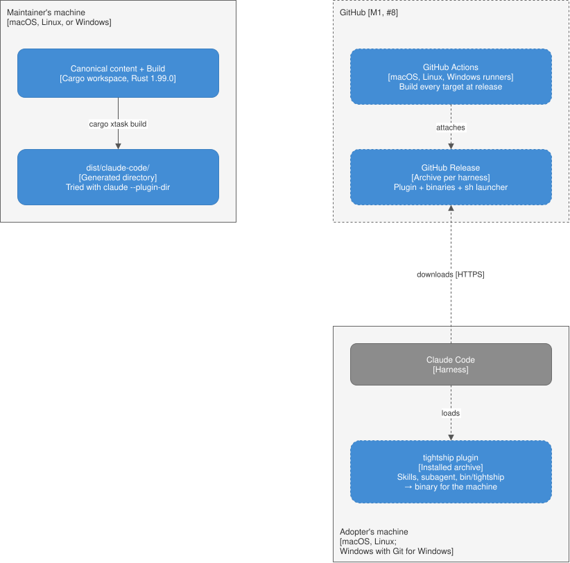

# Deployment

Dashed boxes are not built yet; each belongs to the epic in its label.

| Environment | Runs | Milestone |
| --- | --- | --- |
| Maintainer's machine, macOS, Linux, or Windows | The build, `cargo xtask build` and `cargo xtask scan`, and the gates. The plugin is tried with `claude --plugin-dir dist/claude-code` | M1, #1 |
| GitHub | GitHub Actions builds every target; a GitHub Release holds one archive per harness | M1, #8 |
| Adopter's machine | Claude Code, the installed plugin, and the `tightship` binary its hooks run | M1, #2 and #5 |

## Packaging

The archive of a harness holds its generated plugin and the `tightship` binary for every target:

| Target | Binary |
| --- | --- |
| macOS, arm64 and x86_64 | One universal binary |
| Linux x64 | Statically linked with musl |
| Linux arm64 | Statically linked with musl |
| Windows x64 | `.exe`; Windows arm64 runs it emulated |

`bin/tightship` is a `sh` launcher that picks the binary for the machine. On macOS, the binary carries the
linker's ad-hoc signature only; epic #8 tests that it runs from an archive Claude Code downloaded.

## Installing

The adopter adds the catalogs of ponytail (`DietrichGebert/ponytail`), i-have-adhd (`ayghri/i-have-adhd`),
and humanizer (`blader/humanizer`), then the plugin's catalog, and runs `claude plugin install
tightship@tightship`. Claude Code installs the three companions as the plugin's dependencies (M1, #2). Until
epic #8 publishes a release, the plugin's catalog is the folder `dist/claude-code/`; after it, the catalog
sits at the repository root with an `archive` source pointing at the release's zip.

## Adopter prerequisites

Nothing on macOS and Linux. Git for Windows on Windows, because Claude Code runs hooks under Git Bash and
falls back to PowerShell without it. Git on every system when the memory option is on.

## Delivery

The gates in `AGENTS.md` run on the maintainer's machine. A release is cut from `main` by epic #8's
pipeline, only when the maintainer asks for one.
