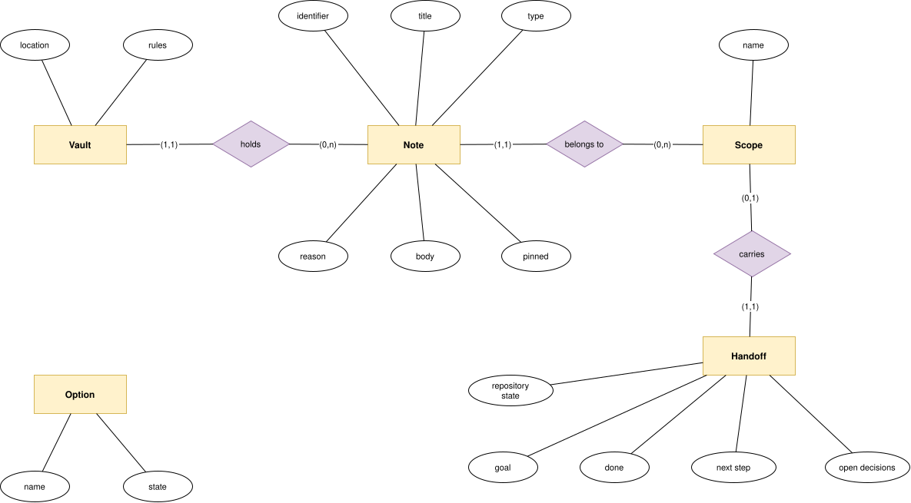

# Data model

The product has no database. Its data is the adopter's vault, a git repository of notes, and the state
of each option in the adopter's harness. The model below comes from the
[memory](../requirements/functional/memory.md) and [installation](../requirements/functional/install.md)
requirements. The logical and physical models and the storage are drawn by the epics that define the
file formats: the options in #3 ([options](options.md)), the vault and its notes in #5 ([vault](vault.md)), and
the handoff's body in #6 ([vault](vault.md#a-handoff)).

## Conceptual model

| Entity | Meaning | Milestone |
| --- | --- | --- |
| Vault | The adopter's git repository of notes, at the location they chose | M1 |
| Note | One curated fact: title, type, the line stating why it matters, a body | M1 |
| Scope | The folder a note belongs to: one project's name, or `all` | M1 |
| Handoff | The note that carries one project's session state to the next session | M1 |
| Option | The contract, the memory layer, or the status line, each enabled or disabled | M1 |

## Invariants

- Releasing a handoff removes the scope's others ([FR-MEM-06](../requirements/functional/memory.md#fr-mem-06)).
- Claiming a handoff removes it from the vault ([FR-MEM-07](../requirements/functional/memory.md#fr-mem-07)).
- A new note gets a new identifier ([FR-MEM-04](../requirements/functional/memory.md#fr-mem-04)).
- A new vault holds the template's rules and no note ([FR-MEM-08](../requirements/functional/memory.md#fr-mem-08)).
- An option keeps its state across an update ([FR-INS-05](../requirements/functional/install.md#fr-ins-05)).
- An option the adopter never set is on ([FR-INS-03](../requirements/functional/install.md#fr-ins-03)).
- No note ever enters this repository ([NFR-SEC-02](../requirements/non-functional/security.md#nfr-sec-02)).

## Contents

- [Access patterns](access-patterns.md)
- [Options](options.md)
- [Vault](vault.md)
