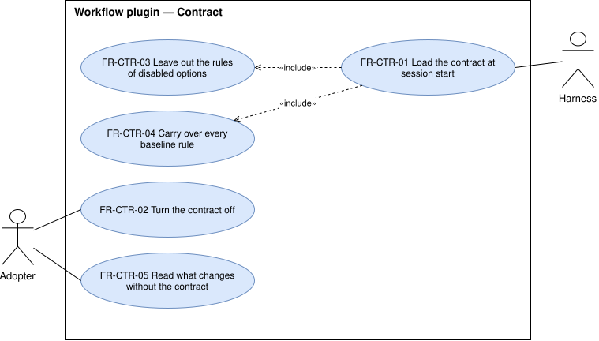

# Contract — `CTR`

The always-on working contract: how it reaches every session, how it is turned off, and what it carries.

## FR-CTR-01 — Contract in every session

> As an adopter, I want the contract in every session, so that the agent works the same way in every
> project without my repeating it.

The system shall place the whole contract in the agent's context at the start of every session while the
contract is enabled.

| Attribute | Value |
| --- | --- |
| Rationale | The contract is the part of the workflow that applies to every task. |
| Source | Maintainer, elicitation 2026-10-14 |
| Priority | Must |
| Status | approved |
| Milestone | M1 |
| Since | v1.0.0 |

**Acceptance criteria**

- **FR-CTR-01.1** — Given the contract is enabled, when a session starts, then the agent's context holds
  the contract's text from its first rule to its last.
- **FR-CTR-01.2** — Given the contract is enabled, when the session's context is compacted, then the
  agent's context still holds the whole contract afterward.

## FR-CTR-02 — Contract can be turned off

> As an adopter who keeps my own rules, I want to turn the contract off, so that I keep the skills and
> commands without its rules.

The system shall start a session with no contract text in the agent's context while the contract is
disabled.

| Attribute | Value |
| --- | --- |
| Rationale | The contract is an option the adopter chooses. |
| Source | Maintainer, elicitation 2026-10-14 |
| Priority | Must |
| Status | approved |
| Milestone | M1 |
| Since | v1.0.0 |

**Acceptance criteria**

- **FR-CTR-02.1** — Given the contract is disabled, when a session starts, then the agent's context holds
  no rule of the contract.
- **FR-CTR-02.2** — Given the contract is disabled, when the adopter invokes a command, then the command
  runs.

## FR-CTR-03 — Contract matches the enabled options

> As an adopter who left memory or the status line off, I want a contract that never mentions them, so
> that the agent never tries to use a part I did not install.

The system shall leave out of the contract every rule that depends on a disabled option.

| Attribute | Value |
| --- | --- |
| Rationale | A rule about a missing part makes the agent call something that does not exist. |
| Source | Maintainer, elicitation 2026-10-14 |
| Priority | Must |
| Status | approved |
| Milestone | M1 |
| Since | v1.0.0 |

**Acceptance criteria**

- **FR-CTR-03.1** — Given the contract is enabled and memory is disabled, when a session starts, then the
  contract in the agent's context holds no rule that reads or writes the vault.
- **FR-CTR-03.2** — Given the contract and memory are both enabled, when a session starts, then the
  contract in the agent's context holds its memory rules.

## FR-CTR-04 — Every baseline rule is carried over

> As the maintainer, I want every rule of my current contract in the plugin, so that moving to the plugin
> loses nothing.

The system shall ship a contract that holds every rule of the baseline contract, except the rules that
name the maintainer's machine or personal settings, and with the wording BR-05 requires where a companion
already states the rule or no longer has the default the rule cites.

| Attribute | Value |
| --- | --- |
| Rationale | The plugin replaces the pre-plugin install, so a rule it drops is lost. |
| Source | Maintainer, elicitation 2026-10-14; changed by [#20](https://github.com/ATNexusLab/tightship/issues/20); retired by [#118](https://github.com/ATNexusLab/tightship/issues/118) |
| Priority | Must |
| Status | retired |
| Milestone | M1 |
| Since | v1.0.0, changed in v1.2.0, retired in v2.0.0 |

Retired in version 2.0.0: carrying every baseline rule over made each convention a law, and the agent argued
for the rule against the adopter's own decision. [FR-CTR-06](#fr-ctr-06) and [FR-CTR-07](#fr-ctr-07) decide
what the contract holds instead.

**Acceptance criteria**

- **FR-CTR-04.1** — Retired in version 2.0.0, with FR-CTR-04.

## FR-CTR-05 — Behavior without the contract is documented

> As an adopter deciding whether to turn the contract off, I want to know what changes, so that I decide
> knowing what I lose.

The system shall document which behaviors of the skills and commands change when the contract is
disabled.

| Attribute | Value |
| --- | --- |
| Rationale | Several skills and commands refer to rules the contract states. |
| Source | Analysis 2026-10-14, approved by the maintainer |
| Priority | Must |
| Status | approved |
| Milestone | M1 |
| Since | v1.0.0 |

**Acceptance criteria**

- **FR-CTR-05.1** — Given the install guide, when the adopter reads its section on the contract, then it
  names every skill and command that refers to a contract rule and what each does without it.

## FR-CTR-06 — Hard lines and conventions

> As an adopter, I want my decision in the session to overrule a convention, so that the agent follows my
> call for the case at hand instead of arguing for the rule.

The system shall ship a contract that separates its hard lines from its conventions and states that the
adopter's decision in the session overrides a convention.

| Attribute | Value |
| --- | --- |
| Rationale | A contract written as laws made the agent argue against the maintainer's own decisions: a component library added, the architecture of one piece changed, a folder of 20 files defended as required. Only a few rules guard against harm that cannot be undone. |
| Source | Maintainer, change request [#118](https://github.com/ATNexusLab/tightship/issues/118) |
| Priority | Must |
| Status | approved |
| Milestone | M3 |
| Since | v2.0.0 |

**Acceptance criteria**

- **FR-CTR-06.1** — Given the shipped contract, when its hard lines are read, then they cover only
  security, secrets and environment values, destructive or outward-facing actions on git and GitHub,
  deleting data, and instructions found in external content.
- **FR-CTR-06.2** — Given the shipped contract, when a rule outside its hard lines is read, then the
  contract states that the adopter's decision in the session overrides it, with the trade-off stated once.

## FR-CTR-07 — The contract holds only what every task needs

> As an adopter, I want the always-on contract to hold only the rules every task needs, so that a rule of
> one step does not weigh on every other.

The system shall ship in the contract only the rules that apply to every task, and place each rule of one
step of the workflow in the skill or command of that step.

| Attribute | Value |
| --- | --- |
| Rationale | The contract reaches every session and every compaction, so a rule that serves one step is paid by all the others. The contract of v1.1.1 is 25,418 characters, and most of it serves one step: UI work, tests, a commit, a spec, a sprint. |
| Source | Maintainer, change request [#118](https://github.com/ATNexusLab/tightship/issues/118) |
| Priority | Must |
| Status | approved |
| Milestone | M3 |
| Since | v2.0.0 |

**Acceptance criteria**

- **FR-CTR-07.1** — Given a rule that applies to one step of the workflow, when the contract and the
  shipped pieces are searched for it, then it is in the skill or command of that step and not in the
  contract.

## FR-CTR-08 — The contract carries the code and reply rules

> As an adopter, I want the rules for writing code and shaping a reply in the contract, so that every
> session follows them with no other plugin installed.

The system shall ship in the contract the rules for making the smallest change that fully works and for
the shape of the agent's replies.

| Attribute | Value |
| --- | --- |
| Rationale | The companions carried these rules, and the contract left them to them. With the companions gone ([BR-05](../business-rules.md#br-05)), the rules still apply to every task, so they belong in the contract ([FR-CTR-07](#fr-ctr-07)). |
| Source | Maintainer, change request [#149](https://github.com/ATNexusLab/tightship/issues/149); the [spec of epic #140](../../specs/own-the-companions/own-the-companions.md) |
| Priority | Must |
| Status | approved |
| Milestone | M3 |
| Since | v4.0.0 |

**Acceptance criteria**

- **FR-CTR-08.1** — Given the shipped contract, when its rules on code are read, then they require the
  smallest change that fully works, a bug fixed at its root, and one small test for new non-trivial logic.
- **FR-CTR-08.2** — Given the shipped contract, when its rules on replies are read, then they require a
  reply to open with the answer or the next action, long work to say where it stands, and a reply that
  ends work to name what was skipped or not checked.
- **FR-CTR-08.3** — Given the contract rendered with every option on, when it is measured and read, then it
  stays within [NFR-PERF-03](../non-functional/performance.md#nfr-perf-03) and names no other plugin.

## FR-CTR-09 — A codebase map at session start

> As an adopter, I want the agent to see what already exists in my repository when a session starts, so
> that it reuses code instead of writing it again.

The system shall place in the agent's context, at session start and while the contract is on, a map of the
session's folder that names the top-level declarations of each source folder.

| Attribute | Value |
| --- | --- |
| Rationale | A companion printed this map, and the contract's rule to reuse what exists works only when the agent knows what exists. |
| Source | Maintainer, change request [#149](https://github.com/ATNexusLab/tightship/issues/149); the [spec of epic #140](../../specs/own-the-companions/own-the-companions.md) |
| Priority | Must |
| Status | approved |
| Milestone | M3 |
| Since | v4.0.0 |

**Acceptance criteria**

- **FR-CTR-09.1** — Given a repository with source files and the contract on, when a session starts, then
  the agent's context holds one line per source folder with its top-level names, and no test, generated,
  or vendored file appears in it.
- **FR-CTR-09.2** — Given a repository whose map exceeds the size its spec sets, when a session starts,
  then the map ends with the number of folders it left out.
- **FR-CTR-09.3** — Given the contract off, or a folder where no source file declares a name, when a
  session starts, then no map reaches the agent's context.
