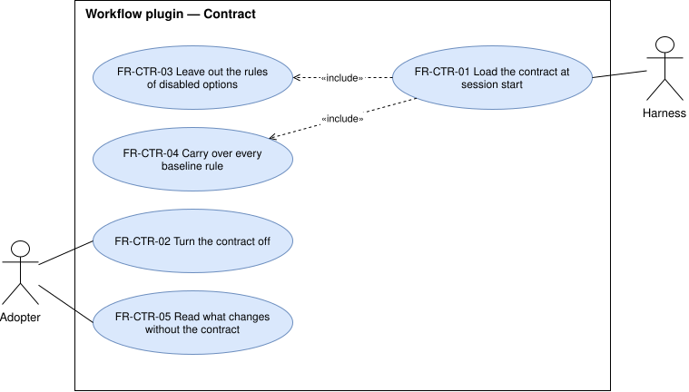

# Contract — `CTR`

The always-on working contract: how it reaches every session, how it is turned off, and what it carries.

## FR-CTR-01 — Contract in every session

> As an adopter, I want the contract in every session, so that the agent works the same way in every
> project without my repeating it.

The system shall place the whole contract in the agent's context at the start of every session while the
contract is enabled.

| Attribute | Value |
| --- | --- |
| Rationale | The contract is the part of the workflow that applies to every task. |
| Source | Maintainer, elicitation 2026-10-14 |
| Priority | Must |
| Status | approved |
| Milestone | M1 |
| Since | v1.0.0 |

**Acceptance criteria**

- **FR-CTR-01.1** — Given the contract is enabled, when a session starts, then the agent's context holds
  the contract's text from its first rule to its last.
- **FR-CTR-01.2** — Given the contract is enabled, when the session's context is compacted, then the
  agent's context still holds the whole contract afterward.

## FR-CTR-02 — Contract can be turned off

> As an adopter who keeps my own rules, I want to turn the contract off, so that I keep the skills and
> commands without its rules.

The system shall start a session with no contract text in the agent's context while the contract is
disabled.

| Attribute | Value |
| --- | --- |
| Rationale | The contract is an option the adopter chooses. |
| Source | Maintainer, elicitation 2026-10-14 |
| Priority | Must |
| Status | approved |
| Milestone | M1 |
| Since | v1.0.0 |

**Acceptance criteria**

- **FR-CTR-02.1** — Given the contract is disabled, when a session starts, then the agent's context holds
  no rule of the contract.
- **FR-CTR-02.2** — Given the contract is disabled, when the adopter invokes a command, then the command
  runs.

## FR-CTR-03 — Contract matches the enabled options

> As an adopter who left memory or the status line off, I want a contract that never mentions them, so
> that the agent never tries to use a part I did not install.

The system shall leave out of the contract every rule that depends on a disabled option.

| Attribute | Value |
| --- | --- |
| Rationale | A rule about a missing part makes the agent call something that does not exist. |
| Source | Maintainer, elicitation 2026-10-14 |
| Priority | Must |
| Status | approved |
| Milestone | M1 |
| Since | v1.0.0 |

**Acceptance criteria**

- **FR-CTR-03.1** — Given the contract is enabled and memory is disabled, when a session starts, then the
  contract in the agent's context holds no rule that reads or writes the vault.
- **FR-CTR-03.2** — Given the contract and memory are both enabled, when a session starts, then the
  contract in the agent's context holds every memory rule of the baseline.

## FR-CTR-04 — Every baseline rule is carried over

> As the maintainer, I want every rule of my current contract in the plugin, so that moving to the plugin
> loses nothing.

The system shall ship a contract that holds every rule of the baseline contract, except the rules that
name the maintainer's machine or personal settings.

| Attribute | Value |
| --- | --- |
| Rationale | The plugin replaces the pre-plugin install, so a rule it drops is lost. |
| Source | Maintainer, elicitation 2026-10-14 |
| Priority | Must |
| Status | approved |
| Milestone | M1 |
| Since | v1.0.0 |

**Acceptance criteria**

- **FR-CTR-04.1** — Given the baseline contract, when each of its rules is looked up in the shipped
  contract, then each one is found or is listed in the spec of M1 as personal, with its reason.

## FR-CTR-05 — Behavior without the contract is documented

> As an adopter deciding whether to turn the contract off, I want to know what changes, so that I decide
> knowing what I lose.

The system shall document which behaviors of the skills and commands change when the contract is
disabled.

| Attribute | Value |
| --- | --- |
| Rationale | Several skills and commands refer to rules the contract states. |
| Source | Analysis 2026-10-14, approved by the maintainer |
| Priority | Must |
| Status | approved |
| Milestone | M1 |
| Since | v1.0.0 |

**Acceptance criteria**

- **FR-CTR-05.1** — Given the install guide, when the adopter reads its section on the contract, then it
  names every skill and command that refers to a contract rule and what each does without it.
