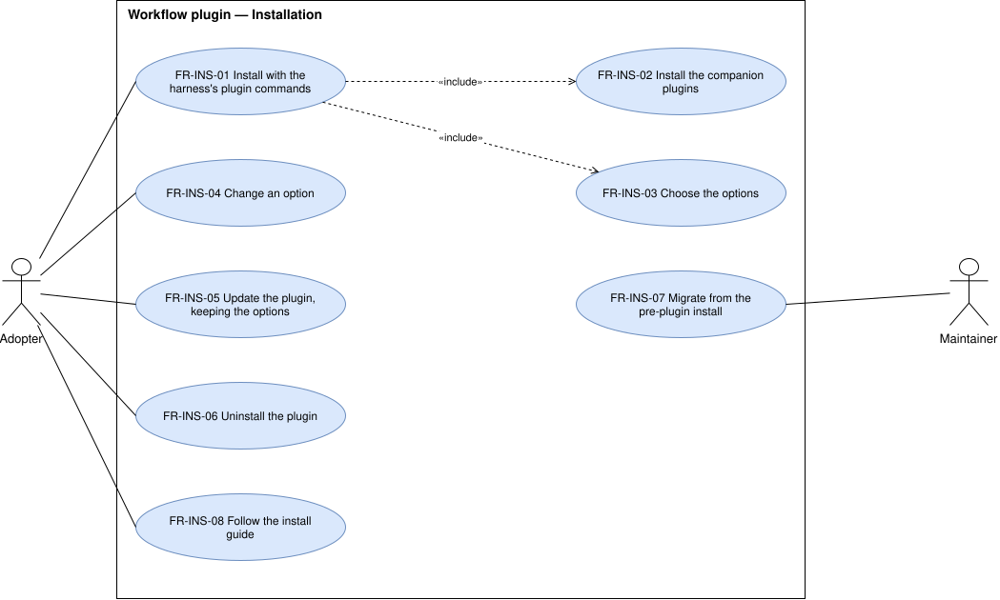

# Installation — `INS`

How the plugin is installed, configured, updated, removed, and how the pre-plugin install moves to it.

## FR-INS-01 — Install through the harness's plugin mechanism

> As an adopter, I want to install the workflow the way my harness installs any plugin, so that I need no
> script and no manual copy.

The system shall be installable from this repository with the harness's own plugin commands.

| Attribute | Value |
| --- | --- |
| Rationale | The pre-plugin install merges files into a user directory by a guided script, which reaches one harness. |
| Source | Maintainer, elicitation 2026-10-14 |
| Priority | Must |
| Status | approved |
| Milestone | M1 |
| Since | v1.0.0 |

**Acceptance criteria**

- **FR-INS-01.1** — Given a machine without the workflow, when the adopter runs the harness's plugin
  commands the install guide lists, then the plugin is installed and its skills and commands are
  available.

## FR-INS-02 — Companions are installed with the plugin

> As an adopter, I want the companion plugins installed with the workflow, so that I never run it without
> them.

The system shall install ponytail, i-have-adhd, and humanizer together with the plugin in every harness
whose plugin mechanism allows it.

| Attribute | Value |
| --- | --- |
| Rationale | [BR-04](../business-rules.md#br-04) makes them required. |
| Source | Maintainer, elicitation 2026-10-14 |
| Priority | Must |
| Status | approved |
| Milestone | M1 |
| Since | v1.0.0 |

**Acceptance criteria**

- **FR-INS-02.1** — Given a harness whose plugin mechanism installs dependencies, when the adopter
  installs the plugin, then the three companions are installed too.
- **FR-INS-02.2** — Given a harness whose plugin mechanism does not, when the adopter follows the install
  guide, then the guide installs the three companions before the plugin.

## FR-INS-03 — Choose the options

> As an adopter, I want to choose which options to turn on when I install, so that I get only the parts I
> use.

The system shall let the adopter enable or disable the contract, the memory layer, and the status line
at installation.

| Attribute | Value |
| --- | --- |
| Rationale | The three are optional by the maintainer's decision. |
| Source | Maintainer, elicitation 2026-10-14 |
| Priority | Must |
| Status | approved |
| Milestone | M1 |
| Since | v1.0.0 |

**Acceptance criteria**

- **FR-INS-03.1** — Given the adopter installs, when they choose a state for each option, then each
  option is in the chosen state in the next session.
- **FR-INS-03.2** — Given the harness could not ask, when the plugin is installed, then each option is
  enabled.

## FR-INS-04 — Change a choice after installation

> As an adopter, I want to turn an option on or off later, so that I need not reinstall to change my mind.

The system shall let the adopter change the state of each option after installation.

| Attribute | Value |
| --- | --- |
| Rationale | An adopter learns what they need by using the workflow. |
| Source | Analysis 2026-10-14, approved by the maintainer |
| Priority | Should |
| Status | approved |
| Milestone | M1 |
| Since | v1.0.0 |

**Acceptance criteria**

- **FR-INS-04.1** — Given an option is enabled, when the adopter disables it, then the next session runs
  with it disabled.

## FR-INS-05 — Update keeps the choices

> As an adopter, I want an update to keep my options, so that updating never changes how I work.

The system shall keep the state of every option across an update of the plugin.

| Attribute | Value |
| --- | --- |
| Rationale | An update that resets options turns parts on or off without the adopter knowing. |
| Source | Analysis 2026-10-14, approved by the maintainer |
| Priority | Must |
| Status | approved |
| Milestone | M1 |
| Since | v1.0.0 |

**Acceptance criteria**

- **FR-INS-05.1** — Given the adopter changed an option from its default, when the plugin is updated to a
  new release, then that option keeps the adopter's state.

## FR-INS-06 — Uninstall leaves nothing behind

> As an adopter, I want the uninstall to remove everything the plugin added, so that my harness is as it
> was before.

The system shall leave, after an uninstall that follows the install guide, no file, setting, or hook that
the plugin added, except the vault.

| Attribute | Value |
| --- | --- |
| Rationale | The vault is the adopter's data; everything else is the plugin's. Claude Code runs no plugin code on uninstall, so the steps that undo what the plugin wrote into the adopter's settings are the guide's. |
| Source | Analysis 2026-10-14, approved by the maintainer; change request [#31](https://github.com/ATNexusLab/tightship/issues/31) |
| Priority | Should |
| Status | approved |
| Milestone | M1 |
| Since | v1.0.0, changed in v1.6.0 |

**Acceptance criteria**

- **FR-INS-06.1** — Given the plugin was installed with every option on, when the adopter follows the
  install guide's uninstall steps, then the harness's user directory holds nothing the plugin added and
  the vault is unchanged.

## FR-INS-07 — Guided migration from the pre-plugin install

> As the maintainer, I want to be guided from the pre-plugin install to the plugin, so that I move without
> losing my personal settings or my vault.

The system shall guide an adopter with the pre-plugin install through removing the workflow pieces it
merged, keeping the personal settings and the vault.

| Attribute | Value |
| --- | --- |
| Rationale | With both installed, each piece loads twice. |
| Source | Maintainer, elicitation 2026-10-14 |
| Priority | Must |
| Status | approved |
| Milestone | M1 |
| Since | v1.0.0 |

**Acceptance criteria**

- **FR-INS-07.1** — Given a machine with the baseline installed, when the adopter follows the migration
  and installs the plugin, then no skill, command, subagent, or hook loads twice in a session.
- **FR-INS-07.2** — Given the same machine, when the migration ends, then every personal setting and every
  vault note it had before is unchanged.

## FR-INS-08 — Install guide per harness

> As an adopter, I want an install guide for my harness, so that I install, configure, update, and remove
> the plugin without asking anyone.

The system shall provide, for each supported harness, a guide covering installation, the companions, the
options, update, uninstall, and migration.

| Attribute | Value |
| --- | --- |
| Rationale | Each harness's plugin commands differ. |
| Source | Analysis 2026-10-14, approved by the maintainer |
| Priority | Must |
| Status | approved |
| Milestone | M1 |
| Since | v1.0.0 |

**Acceptance criteria**

- **FR-INS-08.1** — Given a supported harness, when the adopter opens its guide, then it holds a section
  for each of the six subjects.
