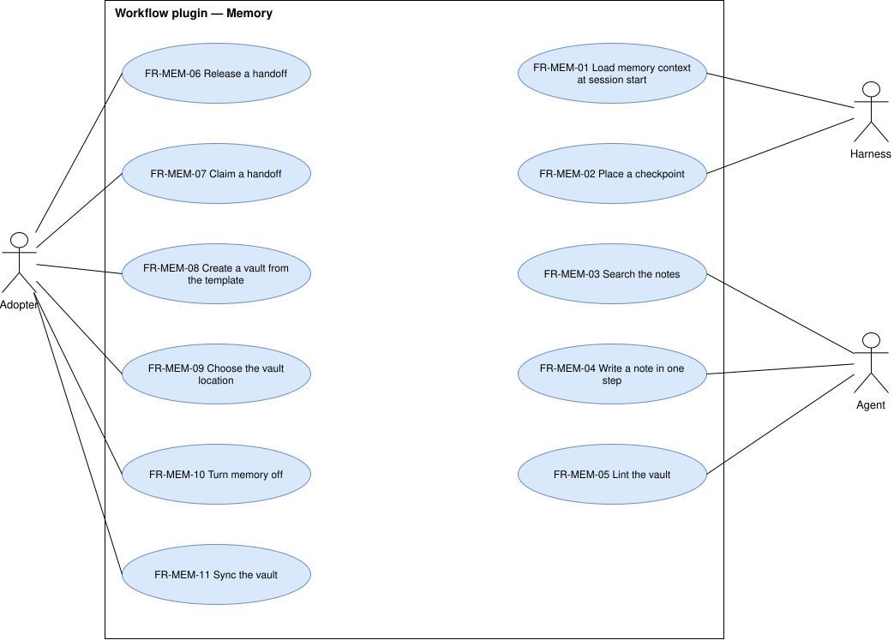

# Memory — `MEM`

The optional memory layer: a vault of curated notes, what reaches the session from it, and how notes and
handoffs are written.

## FR-MEM-01 — Memory context at session start

> As an adopter, I want the notes that matter to this project at the start of each session, so that the
> agent begins with them without my asking.

The system shall place in the agent's context, at session start, the pinned notes of the project's scope
and of `all`, the project's handoff when one exists, and the project's notes waiting to move into a
repository.

| Attribute | Value |
| --- | --- |
| Rationale | A pinned note or a handoff is useful only if the session sees it before it starts working. A note waiting to move into a repository is a debt that stays in the vault until a session in that project sees it: the maintainer's vault held 41 of them, the oldest from July 2026. |
| Source | Maintainer, elicitation 2026-10-14; baseline; change request [#118](https://github.com/ATNexusLab/tightship/issues/118) |
| Priority | Must |
| Status | approved |
| Milestone | M1 |
| Since | v1.0.0, changed in v1.11.0 |

**Acceptance criteria**

- **FR-MEM-01.1** — Given memory is enabled and the vault holds a pinned note in the project's scope, when
  a session starts in that project, then the agent's context lists that note.
- **FR-MEM-01.2** — Given memory is enabled and the project has a handoff, when a session starts, then
  the agent's context holds the handoff's body.
- **FR-MEM-01.3** — Given memory is enabled and a note is in another project's scope, when a session
  starts, then the agent's context does not list it.
- **FR-MEM-01.4** — Given memory is enabled and a note in the project's scope is tagged to move into a
  repository, when a session starts in that project, then the agent's context lists that note as a debt.

## FR-MEM-02 — Checkpoint reminder

> As an adopter, I want the agent reminded to record what it learned, so that a fact worth keeping is not
> lost when the session ends.

The system shall place a checkpoint in the agent's context right after the session's context is compacted.

| Attribute | Value |
| --- | --- |
| Rationale | A compaction drops what the session learned, so the checkpoint comes in the context that follows it: no harness hook adds text to the context before one. A reminder at a prompt interval pushed the agent to write notes nobody asked for, 307 of the 417 notes in the maintainer's vault on 2026-10-20. |
| Source | Maintainer, elicitation 2026-10-14; baseline; change requests [#22](https://github.com/ATNexusLab/tightship/issues/22) and [#118](https://github.com/ATNexusLab/tightship/issues/118) |
| Priority | Must |
| Status | approved |
| Milestone | M1 |
| Since | v1.0.0, changed in v1.3.0 and v1.11.0 |

**Acceptance criteria**

- **FR-MEM-02.1** — Retired in version 1.11.0: a checkpoint at a prompt interval made the agent write
  notes that fail the vault's rules ([#118](https://github.com/ATNexusLab/tightship/issues/118)).
- **FR-MEM-02.2** — Given memory is enabled, when the session's context is compacted, then the context
  that follows the compaction holds a checkpoint.

## FR-MEM-03 — Search the notes

> As an adopter, I want the agent to search the vault, so that it finds a note it was not shown at
> session start.

The system shall return the notes that match the terms of a search, with each note's path and the line
stating why it matters.

| Attribute | Value |
| --- | --- |
| Rationale | Only pinned notes reach the session start, so every other note is reached by search. |
| Source | Maintainer, elicitation 2026-10-14; baseline |
| Priority | Must |
| Status | approved |
| Milestone | M1 |
| Since | v1.0.0 |

**Acceptance criteria**

- **FR-MEM-03.1** — Given a note whose title holds a term, when the agent searches for that term, then the
  note is in the result with its path and its reason line.
- **FR-MEM-03.2** — Given matches in the project's scope and in `all`, when the agent searches, then the
  project's matches come first.

## FR-MEM-04 — Write a note in one step

> As an adopter, I want the agent to write a note in one step, so that recording a fact costs no more
> than stating it.

The system shall create a note in the vault from a title, a scope, a type, a reason line, and a body,
in one invocation.

| Attribute | Value |
| --- | --- |
| Rationale | A write that takes several steps is skipped. |
| Source | Maintainer, elicitation 2026-10-14; baseline |
| Priority | Must |
| Status | approved |
| Milestone | M1 |
| Since | v1.0.0 |

**Acceptance criteria**

- **FR-MEM-04.1** — Given memory is enabled, when the agent writes a note in one invocation, then the
  vault holds the note in its scope's folder with a new identifier and the fields given.

## FR-MEM-05 — Lint the vault

> As an adopter, I want the vault checked against its rules, so that a malformed note is found before it
> misleads a session.

The system shall report every note that breaks the vault's rules, with the rule each one breaks.

| Attribute | Value |
| --- | --- |
| Rationale | A note with a missing field or a broken link degrades search and the session start. |
| Source | Maintainer, elicitation 2026-10-14; baseline |
| Priority | Must |
| Status | approved |
| Milestone | M1 |
| Since | v1.0.0 |

**Acceptance criteria**

- **FR-MEM-05.1** — Given a note without a required field, when the vault is linted, then the report
  names that note and the missing field, and the lint exits with failure.
- **FR-MEM-05.2** — Given a vault where every note follows the rules, when it is linted, then it exits
  with success.

## FR-MEM-06 — Release a handoff

> As an adopter stopping work midway, I want the session's state released as a handoff, so that the next
> session continues from it on any machine or harness.

The system shall write the project's handoff to the vault, replacing the previous one, from the goal,
what is done, the next step, the open decisions, and the repository's state.

| Attribute | Value |
| --- | --- |
| Rationale | Switching machine, operating system, or harness mid-task loses the session's state otherwise. |
| Source | Maintainer, elicitation 2026-10-14; baseline |
| Priority | Must |
| Status | approved |
| Milestone | M1 |
| Since | v1.0.0 |

**Acceptance criteria**

- **FR-MEM-06.1** — Given memory is enabled, when the adopter releases a handoff, then the vault holds
  exactly one handoff for the project's scope, with the five parts of its body.
- **FR-MEM-06.2** — Given a handoff is released, when it finishes, then the project's repository has no
  new commit, push, stash, or checkout made by it.

## FR-MEM-07 — Claim a handoff

> As an adopter resuming work, I want to claim the waiting handoff, so that I continue from where the
> last session stopped.

The system shall move the project's handoff from the vault into the session.

| Attribute | Value |
| --- | --- |
| Rationale | A handoff left in place after it is picked up misleads the next session. |
| Source | Maintainer, elicitation 2026-10-14; baseline |
| Priority | Must |
| Status | approved |
| Milestone | M1 |
| Since | v1.0.0 |

**Acceptance criteria**

- **FR-MEM-07.1** — Given a handoff exists for the project, when the adopter claims it, then the agent
  shows its next step and its open decisions, and the vault no longer holds it.
- **FR-MEM-07.2** — Given the handoff names a commit the repository does not have, when the adopter claims
  it, then the agent names that difference.
- **FR-MEM-07.3** — Given no handoff exists for the project, when the adopter claims one, then the agent
  says so and changes nothing.

## FR-MEM-08 — Create a vault from the template

> As an adopter starting with memory, I want a vault created from the template, so that I begin with its
> rules in place.

The system shall create an empty vault, holding the template's rules and no note, at the location the
adopter chose.

| Attribute | Value |
| --- | --- |
| Rationale | An adopter has no vault before the first install, and the rules are what make it usable. |
| Source | Maintainer, elicitation 2026-10-14; baseline |
| Priority | Must |
| Status | approved |
| Milestone | M1 |
| Since | v1.0.0 |

**Acceptance criteria**

- **FR-MEM-08.1** — Given no vault at the chosen location, when the adopter creates one, then the location
  holds a git repository with the template's rules and no note.
- **FR-MEM-08.2** — Given a vault already at the chosen location, when the adopter creates one, then
  nothing in it changes and the adopter is told.

## FR-MEM-09 — Vault location is the adopter's choice

> As an adopter, I want to choose where the vault lives, so that it fits my machine's layout.

The system shall read and write the vault at the location the adopter chose.

| Attribute | Value |
| --- | --- |
| Rationale | A fixed path does not fit every machine or operating system. |
| Source | Maintainer, elicitation 2026-10-14; `~` by change request [#57](https://github.com/ATNexusLab/tightship/issues/57) |
| Priority | Must |
| Status | approved |
| Milestone | M1 |
| Since | v1.0.0 |

**Acceptance criteria**

- **FR-MEM-09.1** — Given the adopter chose a location other than the baseline's default, when any memory
  function runs, then it reads and writes only at that location.
- **FR-MEM-09.2** — Given the adopter chose a location that is `~` alone or starts with `~` and a path
  separator, when any memory function runs, then it reads and writes under the user's home folder, on macOS,
  Linux, and Windows.

## FR-MEM-10 — Memory can be turned off

> As an adopter without a vault, I want memory off, so that nothing in a session expects one.

The system shall run no memory function while memory is disabled.

| Attribute | Value |
| --- | --- |
| Rationale | Memory is an option the adopter chooses. |
| Source | Maintainer, elicitation 2026-10-14 |
| Priority | Must |
| Status | approved |
| Milestone | M1 |
| Since | v1.0.0 |

**Acceptance criteria**

- **FR-MEM-10.1** — Given memory is disabled, when a session starts and its context is compacted, then
  the agent's context receives no memory context and no checkpoint.
- **FR-MEM-10.2** — Given memory is disabled, when the adopter invokes the handoff command, then the agent
  says memory is off and changes nothing.

## FR-MEM-11 — Sync the vault

> As an adopter working on more than one machine, I want to sync the vault with one command, so that each
> machine sees the notes the others wrote without my spelling out the git steps.

The system shall, at the adopter's request, record the vault's local changes, take in the changes of the
vault's git remote, give a new id to a local note whose id the remote already took, and send the local changes
to that remote.

| Attribute | Value |
| --- | --- |
| Rationale | Syncing takes a request in free text, and two machines that write before syncing give two notes the same id. |
| Source | Maintainer, change request [#23](https://github.com/ATNexusLab/tightship/issues/23) |
| Priority | Must |
| Status | approved |
| Milestone | M1 |
| Since | v1.4.0 |

**Acceptance criteria**

- **FR-MEM-11.1** — Given the vault and its remote each hold a note the other lacks, when the adopter syncs,
  then both hold both notes.
- **FR-MEM-11.2** — Given a note changed on both sides, when the adopter syncs and git cannot merge the two,
  then the remote is unchanged, the vault holds both versions for the agent to resolve, and the agent is told
  which notes conflict.
- **FR-MEM-11.3** — Given a note written locally and a note from the remote have the same id, when the
  adopter syncs, then the local note gets a new id and every link to it follows.

## FR-MEM-12 — Notes expire

> As an adopter, I want a note that nobody revised in its lifetime removed from the vault, so that the
> vault keeps only what is still worth reading.

The system shall remove from the vault, at each sync, every note whose type's lifetime has passed since
the note was last updated, except pinned notes, notes the user stated, decisions, preferences, and handoffs.

| Attribute | Value |
| --- | --- |
| Rationale | Nothing removes a note unless a person prunes by hand, and pruning by hand did not hold: the maintainer's vault went from 213 notes to 418 in the 19 days after a prune. A lifetime by type is how [akitaonrails/ai-memory](https://github.com/akitaonrails/ai-memory) and the tools it surveys age notes, with no new field per note. |
| Source | Maintainer, change request [#118](https://github.com/ATNexusLab/tightship/issues/118) |
| Priority | Must |
| Status | approved |
| Milestone | M4 |
| Since | v1.11.0 |

**Acceptance criteria**

- **FR-MEM-12.1** — Given a note whose type's lifetime has passed since it was last updated, when the
  adopter syncs, then the vault and its remote no longer hold it, and the vault's git history does.
- **FR-MEM-12.2** — Given a note past its type's lifetime that is pinned, stated by the user, a decision,
  a preference, or a handoff, when the adopter syncs, then the vault still holds it.
- **FR-MEM-12.3** — Given a note rewritten in place before its lifetime passed, when the adopter syncs
  after the date the old version would have expired, then the vault still holds it.

## FR-MEM-13 — The vault's rules follow the plugin

> As an adopter, I want the vault's rules updated with the plugin, so that a change to the rules reaches
> my vault without my copying it.

The system shall keep one delimited block of the vault's `AGENTS.md` equal to the rules of the vault
template the installed plugin ships, and leave the text outside the block unchanged.

| Attribute | Value |
| --- | --- |
| Rationale | Creating a vault copies the template once, so the rules of an older vault fall behind: the maintainer's vault still describes a `vault.py` that no longer exists. A delimited block lets the adopter keep rules of their own next to it. |
| Source | Maintainer, change request [#118](https://github.com/ATNexusLab/tightship/issues/118) |
| Priority | Must |
| Status | approved |
| Milestone | M4 |
| Since | v1.11.0 |

**Acceptance criteria**

- **FR-MEM-13.1** — Given the vault's block is missing or differs from the installed template's rules,
  when the adopter syncs, then the block holds the template's rules.
- **FR-MEM-13.2** — Given the vault's `AGENTS.md` holds text outside the block, when the adopter syncs,
  then that text is unchanged.
