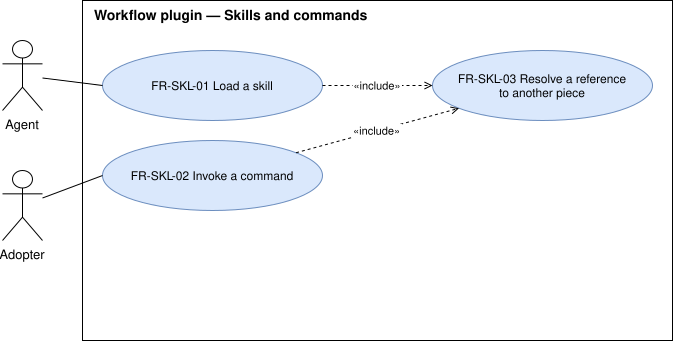

# Skills and commands — `SKL`

The skills the agent loads on demand and the commands the adopter invokes.

## FR-SKL-01 — Skills available

> As an adopter, I want the workflow's skills in my harness, so that the agent loads each one when a task
> matches it.

The system shall make each of the 13 skills of the baseline available to the agent.

| Attribute | Value |
| --- | --- |
| Rationale | The skills carry the method for each kind of task. |
| Source | Maintainer, elicitation 2026-10-14 |
| Priority | Must |
| Status | approved |
| Milestone | M1 |
| Since | v1.0.0 |

**Acceptance criteria**

- **FR-SKL-01.1** — Given the plugin is installed, when the adopter lists the skills the harness offers,
  then each of the 13 baseline skills is listed.
- **FR-SKL-01.2** — Given the plugin is installed, when a skill is loaded, then the agent receives its
  whole text and every file it points to.

## FR-SKL-02 — Commands invocable

> As an adopter, I want the workflow's commands in my harness, so that I run each step of the
> development loop by name.

The system shall make each of the 9 commands of the baseline invocable by the adopter.

| Attribute | Value |
| --- | --- |
| Rationale | The commands are how the adopter drives the development loop. |
| Source | Maintainer, elicitation 2026-10-14 |
| Priority | Must |
| Status | approved |
| Milestone | M1 |
| Since | v1.0.0 |

**Acceptance criteria**

- **FR-SKL-02.1** — Given the plugin is installed, when the adopter invokes any of the 9 baseline
  commands, then the agent receives that command's instructions with the adopter's arguments.

## FR-SKL-03 — References resolve

> As an adopter, I want every name a piece refers to to exist in my install, so that no instruction
> points at something missing.

The system shall resolve every reference from one shipped piece to another skill, command, subagent, or
script in the installed plugin.

| Attribute | Value |
| --- | --- |
| Rationale | A harness can rename or namespace plugin pieces, which breaks a reference written for the pre-plugin install. |
| Source | Analysis 2026-10-14, approved by the maintainer |
| Priority | Must |
| Status | approved |
| Milestone | M1 |
| Since | v1.0.0 |

**Acceptance criteria**

- **FR-SKL-03.1** — Given the built plugin, when every reference in its shipped pieces is checked, then
  each one names a piece present in that plugin under the name the harness gives it.

## FR-SKL-04 — The bootstrap writes a lean repository contract

> As an adopter, I want my repository's `AGENTS.md` to hold only what every task in it needs, so that the
> agent does not carry what the repository already shows or what serves one area.

The system shall write, through the bootstrap command, an `AGENTS.md` that holds only what applies to every
task in the repository and that its files do not show, and that describes the architecture as the current
shape, which the adopter may change.

| Attribute | Value |
| --- | --- |
| Rationale | The repository contract is read at every session, like the contract. Commands the build files state, procedures of one area, and an architecture to conform to strictly made it long, and made the agent defend the current shape against the adopter's decision to change it. |
| Source | Maintainer, change request [#118](https://github.com/ATNexusLab/tightship/issues/118) |
| Priority | Must |
| Status | approved |
| Milestone | M4 |
| Since | v2.0.0 |

**Acceptance criteria**

- **FR-SKL-04.1** — Given a repository with no `AGENTS.md`, when the adopter runs the bootstrap command,
  then the `AGENTS.md` it writes states no command, path, or structure the repository's files state, and no
  procedure of one area or step.
- **FR-SKL-04.2** — Given a repository whose `AGENTS.md` holds such text, when the adopter runs the
  bootstrap command, then it proposes the cut and changes the file only once the adopter approves.

## FR-SKL-05 — The bootstrap writes project skills

> As an adopter, I want each procedure of one area or step of my repository as a project skill, so that the
> agent loads it only when the task needs it.

The system shall write, through the bootstrap command, each procedure of one area or step of the repository
as a skill in the repository's `.agents/skills/` folder, and make it reachable from every supported harness.

| Attribute | Value |
| --- | --- |
| Rationale | The workflow gave a repository only its `AGENTS.md`, so every procedure went there and was read at every session. `.agents/skills/` is the folder of the open Agent Skills format, the most general one the harnesses read. |
| Source | Maintainer, change request [#118](https://github.com/ATNexusLab/tightship/issues/118) |
| Priority | Must |
| Status | approved |
| Milestone | M4 |
| Since | v2.0.0 |

**Acceptance criteria**

- **FR-SKL-05.1** — Given a repository with a procedure of one area or step, when the adopter runs the
  bootstrap command, then `.agents/skills/<name>/SKILL.md` holds that procedure.
- **FR-SKL-05.2** — Given a supported harness that does not read `.agents/skills/`, when a session starts
  in a repository with project skills, then the harness lists them.
