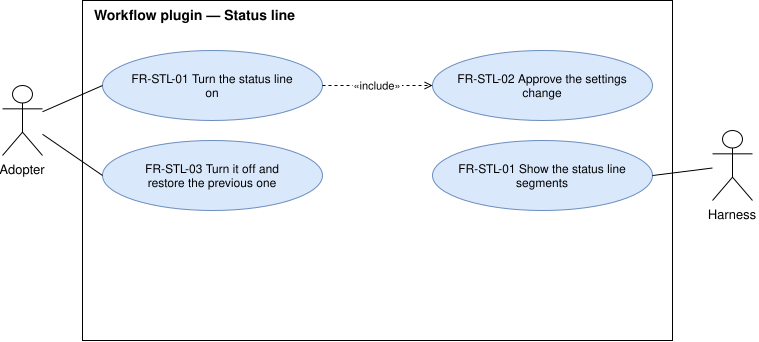

# Status line — `STL`

The optional status line, and the option that is the adopter's consent to change the harness's settings.

## FR-STL-01 — Status line on opt-in

> As an adopter, I want the workflow's status line when I ask for it, so that I see the session's state
> under the prompt.

The system shall show the baseline status line's segments while the status line is enabled.

| Attribute | Value |
| --- | --- |
| Rationale | The status line is part of the workflow the maintainer uses today. |
| Source | Maintainer, elicitation 2026-10-14; baseline |
| Priority | Must |
| Status | approved |
| Milestone | M1 |
| Since | v1.0.0 |

**Acceptance criteria**

- **FR-STL-01.1** — Given the status line is enabled, when a session runs, then the harness shows each
  segment the baseline status line shows for the same session state.

## FR-STL-02 — The status line option is the consent

> As an adopter, I want my settings to change only while I have the status line turned on, so that nothing
> I configured is replaced without my knowing.

The system shall write the status line into the harness's settings only while the adopter has the
`status_line` option on.

| Attribute | Value |
| --- | --- |
| Rationale | The status line may be a setting the adopter owns, outside the plugin. Turning the option on is the adopter's choice, so a second question in chat only added a step, and a recorded no kept the status line off for good ([#55](https://github.com/ATNexusLab/tightship/issues/55)). |
| Source | Analysis 2026-10-14, approved by the maintainer; change request [#55](https://github.com/ATNexusLab/tightship/issues/55), 2026-10-16 |
| Priority | Must |
| Status | approved |
| Milestone | M1 |
| Since | v1.0.0 |

**Acceptance criteria**

- **FR-STL-02.1** — Retired in version 1.9.0: the adopter no longer answers a question in chat, so no
  refusal is recorded ([#55](https://github.com/ATNexusLab/tightship/issues/55)).
- **FR-STL-02.2** — Given the `status_line` option is off, when a session starts, then the harness's
  settings do not hold the workflow's status line.
- **FR-STL-02.3** — Given the `status_line` option is on, when a session starts, then the harness's settings
  hold the workflow's status line, whatever status line they held before.

## FR-STL-03 — Turning it off restores the previous setting

> As an adopter, I want my previous status line back when I turn this one off, so that trying it costs me
> nothing.

The system shall restore the status line setting the adopter had before enabling the workflow's.

| Attribute | Value |
| --- | --- |
| Rationale | An opt-in that cannot be undone cleanly discourages trying it. |
| Source | Analysis 2026-10-14, approved by the maintainer |
| Priority | Should |
| Status | approved |
| Milestone | M1 |
| Since | v1.0.0 |

**Acceptance criteria**

- **FR-STL-03.1** — Given the adopter had a status line before, when they disable the workflow's, then
  the harness's settings hold the previous one exactly.
- **FR-STL-03.2** — Given the adopter had no status line before, when they disable the workflow's, then
  the harness's settings hold none.
