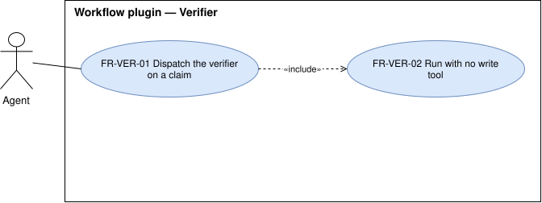

# Verifier — `VER`

The read-only subagent that tries to refute a claim before it is trusted.

## FR-VER-01 — Verifier can be dispatched

> As an adopter, I want the agent to dispatch the verifier, so that a finding or a claim of done is
> challenged by an independent skeptic.

The system shall make the verifier available as a subagent the agent can dispatch.

| Attribute | Value |
| --- | --- |
| Rationale | Skills and commands of the baseline dispatch it. |
| Source | Maintainer, elicitation 2026-10-14 |
| Priority | Must |
| Status | approved |
| Milestone | M1 |
| Since | v1.0.0 |

**Acceptance criteria**

- **FR-VER-01.1** — Given the plugin is installed, when the agent dispatches the verifier with a claim,
  then the verifier returns a verdict on that claim.

## FR-VER-02 — Verifier changes only a private copy

> As an adopter, I want the verifier to leave my repository as it found it, so that a check never alters
> what it checks.

The system shall give the verifier no file-editing tool of the harness; the verifier changes files only
through its shell, in a private copy of the repository.

| Attribute | Value |
| --- | --- |
| Rationale | A verifier that edits can make the claim true instead of testing it, and one without a shell cannot run the tests that prove a claim. |
| Source | Maintainer, elicitation 2026-10-14; changed by [#13](https://github.com/ATNexusLab/tightship/issues/13) |
| Priority | Must |
| Status | approved |
| Milestone | M1 |
| Since | v1.0.0, changed in v1.1.0 |

**Acceptance criteria**

- **FR-VER-02.1** — Given the verifier is running, when it tries to edit a file with the harness's
  file-editing tool, then the harness refuses the action.
- **FR-VER-02.2** — Given a repository, when the verifier returns from checking a claim, then the
  repository's working tree is as it was before.
